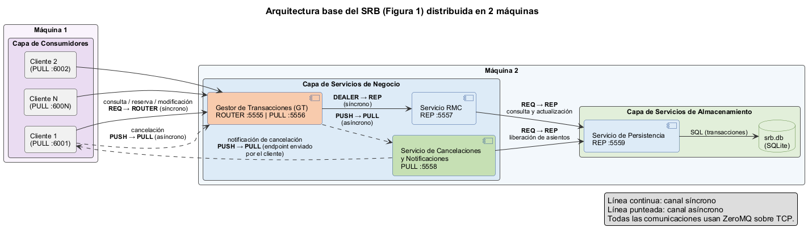
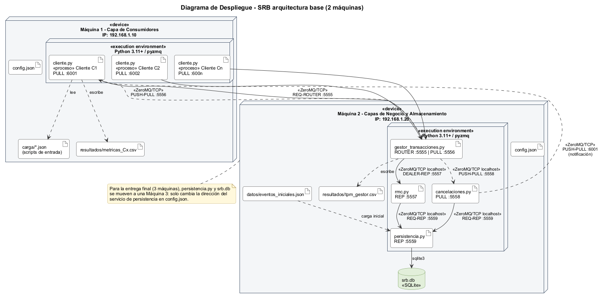
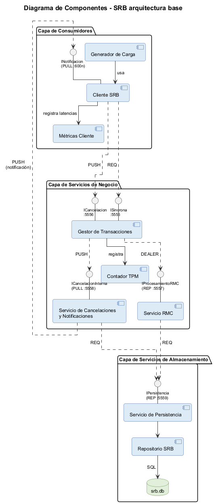
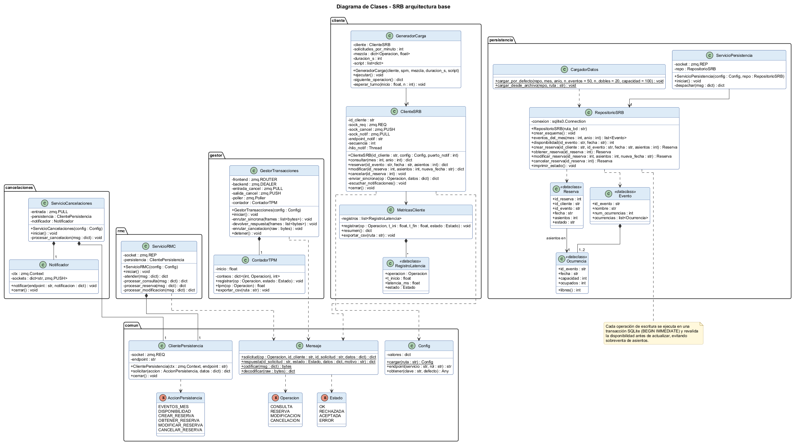
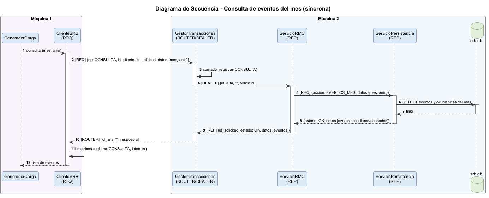
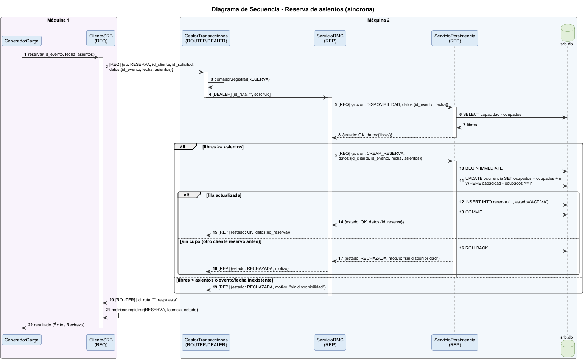
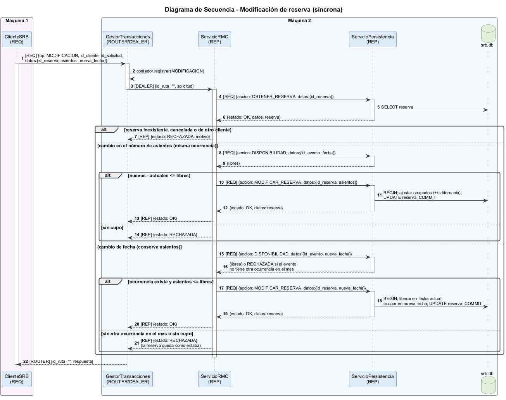
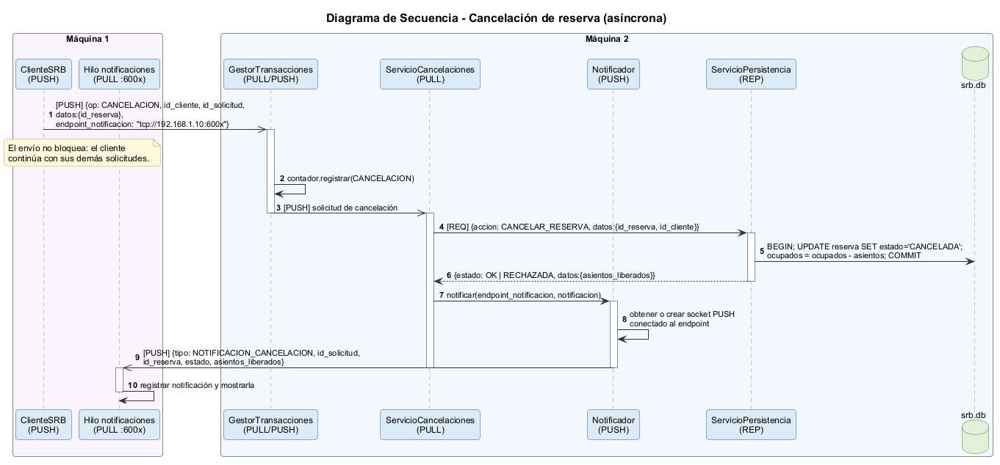

# Sistema de Reserva de Boletos (SRB) – Arquitectura base

**Pontificia Universidad Javeriana – Introducción a Sistemas Distribuidos (2026-30)**
**Integrante:** Nicolas Esteban Jimenez Castiblanco
**Entrega:** Primera entrega – arquitectura base (Figura 1)

---

## 1. Decisiones generales

| Aspecto | Decisión |
|---|---|
| Lenguaje | Python 3.11+ |
| Comunicación | ZeroMQ (`pyzmq`) sobre TCP en todos los servicios |
| Almacenamiento | SQLite (`srb.db`) a través del Servicio de Persistencia |
| Formato de mensajes | JSON codificado en UTF-8 |
| Distribución | 2 máquinas (por indicación del profesor para esta entrega) |
| Configuración | `config.json` con IP y puerto de cada servicio |

## 2. Arquitectura de tres capas

La arquitectura respeta la Figura 1 del enunciado:

1. **Capa de consumidores:** procesos `cliente.py`. Cada proceso genera carga parametrizable (solicitudes por minuto, porcentaje por tipo de operación, duración o script de entrada) y mide la latencia de cada solicitud.
2. **Capa de servicios de negocio:**
   - **Gestor de Transacciones (GT):** puerta de entrada. Separa el canal síncrono (consulta, reserva, modificación) del asíncrono (cancelación) y cuenta las transacciones por minuto (TPM).
   - **Servicio RMC:** atiende las reservas, modificaciones y consultas siguiendo los pasos del enunciado (consultar disponibilidad → actualizar → responder Éxito/Rechazo).
   - **Servicio de Cancelaciones y Notificaciones:** libera los asientos en persistencia y notifica directamente al cliente que hizo la solicitud.
3. **Capa de servicios de almacenamiento:** **Servicio de Persistencia**, único proceso con acceso a `srb.db`. Ejecuta las operaciones CRUD sobre eventos, ocurrencias y reservas.



## 3. Distribución en dos máquinas

| Máquina | Capa | Procesos |
|---|---|---|
| **Máquina 1** (ej. 192.168.1.10) | Consumidores | `cliente.py` × N (cada uno con su puerto de notificación 6001, 6002, …) |
| **Máquina 2** (ej. 192.168.1.20) | Negocio + Almacenamiento | `gestor_transacciones.py`, `rmc.py`, `cancelaciones.py`, `persistencia.py`, `srb.db` |

Los clientes quedan en una máquina distinta de los servicios, así que todas las solicitudes y notificaciones cruzan la red. Las capas de negocio y de almacenamiento comparten la Máquina 2, pero se comunican por TCP igual que si estuvieran separadas. Para pasar a tres máquinas basta con mover `persistencia.py` y `srb.db` a una Máquina 3 y cambiar su dirección en `config.json`; el código no cambia.



## 4. Patrones de comunicación ZeroMQ

| Origen → Destino | Patrón | Tipo | Quién hace `bind` | Puerto |
|---|---|---|---|---|
| Cliente → GT (consulta, reserva, modificación) | REQ → ROUTER | Síncrono | GT | 5555 |
| Cliente → GT (cancelación) | PUSH → PULL | Asíncrono | GT | 5556 |
| GT → RMC | DEALER → REP | Síncrono | RMC | 5557 |
| GT → Cancelaciones | PUSH → PULL (pipeline) | Asíncrono | Cancelaciones | 5558 |
| RMC → Persistencia | REQ → REP | Síncrono | Persistencia | 5559 |
| Cancelaciones → Persistencia | REQ → REP | Síncrono | Persistencia | 5559 |
| Cancelaciones → Cliente (notificación) | PUSH → PULL | Asíncrono | Cliente | 6000 + n |

**Justificación:**

- **REQ/ROUTER en el GT:** el cliente espera la respuesta (síncrono, como exige el enunciado). El ROUTER del GT atiende a muchos clientes a la vez sin bloquearse, porque cada mensaje lleva la identidad del cliente que lo envió.
- **DEALER/REP entre GT y RMC:** el GT reenvía la solicitud con la identidad del cliente (`[id_ruta, "", payload]`). El REP del RMC conserva ese sobre y lo devuelve en la respuesta, así el GT sabe a qué cliente responder sin guardar estado (patrón broker *ROUTER/DEALER* de la guía ZeroMQ). El GT nunca se bloquea esperando al RMC.
- **PUSH/PULL para la cancelación:** el cliente envía la cancelación y sigue con su trabajo sin esperar. El GT la reenvía de inmediato al servicio de cancelaciones, que la procesa después, tal como pide el enunciado.
- **Notificación PUSH/PULL directa al cliente:** el mensaje de cancelación incluye `endpoint_notificacion` (por ejemplo `tcp://192.168.1.10:6001`), que es la dirección del socket PULL del cliente. El Notificador conecta un PUSH a esa dirección (lo reutiliza si ya existe) y envía el resultado. El cliente recibe las notificaciones en un hilo propio, sin interrumpir su generación de carga.
- **Persistencia con REP:** un REP atiende las solicitudes de una en una, en orden. Esto, más las transacciones SQLite, impide que dos reservas simultáneas vendan el mismo asiento.



## 5. Formato de mensajes

**Solicitud del cliente**

```json
{
  "id_solicitud": "C1-000042",
  "id_cliente": "C1",
  "operacion": "RESERVA",
  "ts_envio": 1760190000.123,
  "datos": { "id_evento": "E7", "fecha": "2026-11-14", "asientos": 3 }
}
```

| Operación | `datos` |
|---|---|
| `CONSULTA` | `{ "mes": 11, "anio": 2026 }` |
| `RESERVA` | `{ "id_evento", "fecha", "asientos" }` |
| `MODIFICACION` | `{ "id_reserva", "asientos" }` o `{ "id_reserva", "nueva_fecha" }` |
| `CANCELACION` | `{ "id_reserva" }` + campo `endpoint_notificacion` |

**Respuesta (canal síncrono)**

```json
{ "id_solicitud": "C1-000042", "estado": "OK", "datos": { "id_reserva": 17 }, "motivo": null }
```

`estado` ∈ { `OK`, `RECHAZADA`, `ERROR` }.

**Notificación de cancelación**

```json
{ "tipo": "NOTIFICACION_CANCELACION", "id_solicitud": "C1-000050",
  "id_reserva": 17, "estado": "OK", "asientos_liberados": 3 }
```

**Protocolo interno con Persistencia:** `{ "accion": <AccionPersistencia>, "datos": {...} }`, donde la acción es una de `EVENTOS_MES`, `DISPONIBILIDAD`, `CREAR_RESERVA`, `OBTENER_RESERVA`, `MODIFICAR_RESERVA` o `CANCELAR_RESERVA`.

## 6. Modelo de datos

```
evento     (id_evento PK, nombre, num_ocurrencias)
ocurrencia (id_evento FK, fecha, capacidad, ocupados,  PK(id_evento, fecha))
reserva    (id_reserva PK, id_cliente, id_evento, fecha, asientos, estado, creada_en)
```

- Asientos libres = `capacidad - ocupados`.
- Carga inicial: 50 eventos en un mismo mes (`E1`…`E50`), 20 de ellos con dos ocurrencias; 100 asientos por ocurrencia. También se puede cargar el caso de prueba del profesor desde un archivo JSON.
- Un evento con una sola ocurrencia solo admite cambios en el número de asientos.
- Las escrituras usan `BEGIN IMMEDIATE` y una actualización condicional (`WHERE capacidad - ocupados >= n`), así la disponibilidad se vuelve a validar dentro de la misma transacción.
- El Servicio de Persistencia imprime el estado de la BD al iniciar y después de cada escritura, para mostrarlo en la sustentación.

## 7. Diseño de clases



| Paquete | Clases principales |
|---|---|
| `comun` | `Config`, `Mensaje`, `ClientePersistencia`, enums `Operacion`, `Estado`, `AccionPersistencia` |
| `cliente` | `ClienteSRB`, `GeneradorCarga`, `MetricasCliente`, `RegistroLatencia` |
| `gestor` | `GestorTransacciones`, `ContadorTPM` |
| `rmc` | `ServicioRMC` |
| `cancelaciones` | `ServicioCancelaciones`, `Notificador` |
| `persistencia` | `ServicioPersistencia`, `RepositorioSRB`, `CargadorDatos`, `Evento`, `Ocurrencia`, `Reserva` |

## 8. Interacciones

### Consulta de eventos del mes



### Reserva de asientos



### Modificación de reserva



### Cancelación con notificación



## 9. Alcance de la primera entrega

- **Diseño:** cubre todo el sistema de la Figura 1 (las cuatro operaciones).
- **Implementación:** todos los procesos de la arquitectura base (cliente, Gestor de Transacciones, RMC, Cancelaciones y Persistencia), con las operaciones de **consulta** y **reserva** funcionando de extremo a extremo. Modificación y cancelación quedan diseñadas, no implementadas: el RMC responde `ERROR` a una modificación, y el servicio de Cancelaciones recibe los mensajes del canal asíncrono pero no los ejecuta. No se implementa tolerancia a fallas.
- **Métricas:** cada cliente guarda la latencia de cada solicitud (`MetricasCliente`) y el GT cuenta las transacciones por minuto (`ContadorTPM`). Ambos exportan a CSV para construir la Tabla 1.
- **Diferencias entre el diseño y el código:** los diagramas de clases y de secuencia describen el sistema completo. En el código de esta entrega faltan `Notificador`, las acciones `OBTENER_RESERVA`, `MODIFICAR_RESERVA` y `CANCELAR_RESERVA`, y el hilo de notificaciones del cliente. El código usa módulos planos (`comun.py`, `persistencia.py`, …) en lugar de los paquetes del diagrama.

---

Las fuentes de los diagramas (`diagramas/*.puml`) están en PlantUML. Para regenerar las imágenes:

```
java -jar plantuml.jar -charset UTF-8 -tpng diagramas/0*.puml
```
